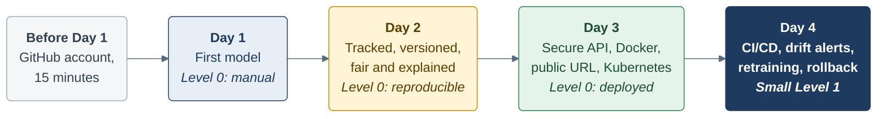

# Machine Guard

Predict which machine runs on a production line are about to fail, then build, ship and watch the model.
This repo grows across the 4 days of *MLOps from Zero to Live*.

## Start here

We set this up together at the start of Day 1 (the setup sheet walks through it):

1. Click **Code → Codespaces → Create codespace on main**. The first build takes 3 to 5 minutes.
2. When the terminal is ready, run the checks:

   ```bash
   python --version
   git --version
   ls data/raw
   python -c "import sklearn, mlflow; print('packages OK')"
   ```

   If the last line fails, the setup step is still running or failed: see the setup sheet.

3. Open `notebooks/00_smoke_test.ipynb`, click **Run All**, then save.
4. **Stop the codespace at the end of every day** (github.com/codespaces → ⋯ → Stop codespace). The free plan includes a fixed number of core-hours per month.

Everything else is set up on the day it is first needed: the MLflow UI on Day 2 (`mlflow ui --backend-store-uri sqlite:///mlflow.db --port 5000`), and a GitHub token, Render, Streamlit and a kind cluster on Day 3.

Some files below are **fill-in versions** with `# TODO` steps: you complete them in the labs on the day they are used. Some are **switched off** until then (the GitHub Actions workflows run only from Day 4).

## What is in here

| Path | Day | What it is |
|---|---|---|
| `.devcontainer/` | | The recipe for the cloud machine: Python 3.11, Docker, kind, kubectl, VS Code extensions |
| `requirements.txt` | | Exact Python package versions for the whole course, so everyone gets the same results |
| `data/raw/` | 1 | The AI4I 2020 sensor data (see `data/README.md`). From Day 2, DVC tracks it |
| `scripts/download_data.py` | 1 | Re-creates `data/raw/ai4i2020.csv` from the original file (CI uses it too) |
| `notebooks/` | 1, 2 | The setup smoke test, the Day 1 notebooks, and Day 2's `04_mlflow_tracking` and `05_slices_fairness_shap` |
| `results/` | 1 | Your hand-recorded experiments and written evaluation |
| `machine_guard/features.py` | all | Shared columns, valid ranges, features and the model pipeline. Everything else imports from it |
| `machine_guard/train.py` | 2 | Training script: `python -m machine_guard.train --help`. Logs to MLflow, registers the model |
| `scripts/make_batch2.py` | 2 | Makes 2,000 new sensor runs ("batch 2") for the data versioning lab |
| `reports/` | 2, 4 | Your slice and explainability note; later the drift report |
| `machine_guard/export_model.py` | 3 | Copies the `champion` model from MLflow into `models/` |
| `models/` | 3 | The exported model and its ID card (`model_meta.json`). Committed, so Docker, Render, CI and Kubernetes can use it |
| `app/` | 3 | The FastAPI service: `/health`, `/predict`, API key check, input validation, JSON and SQLite logs |
| `Dockerfile`, `.dockerignore`, `requirements-serve.txt` | 3 | The serving image (the Dockerfile has two planted mistakes, fixed in the Docker lab) |
| `streamlit_app/` | 3 | The web page that calls the API |
| `k8s/` | 3 | Kubernetes manifests for the kind cluster (`k8s/kind/` holds the cluster config) |
| `scripts/check_kind.sh` | 3 | Quick check that a Kubernetes test cluster starts |
| `machine_guard/validate.py` | 4 | Data validation: a Pandera schema built from the shared valid ranges |
| `machine_guard/quality_gate.py` | 4 | Quality gate: fails if recall on failures is below 0.75 |
| `machine_guard/drift.py` | 4 | Evidently drift report and summary |
| `scripts/simulate_next_quarter.py` | 4 | Makes the "next quarter" and "messy" incoming batches |
| `tests/`, `pytest.ini` | 4 | Unit tests (`pytest`) and integration tests against the running API (`pytest -m integration`) |
| `.github/workflows/` | 4 | CI (validate, test, gate, build and push the image) and the weekly drift alert. Switched off until Day 4 |
| `flows/retrain_flow.py` | 4 | Prefect retraining flow: validate, check drift, retrain, evaluate, promote only if it passes the gate |
| `docs/` | 4 | Incident runbook, model card, architecture page and the capstone README template |

## Progress



| Day | What Machine Guard can do by the end of the day |
|---|---|
| 1 | Notebook, first model, written evaluation, on GitHub |
| 2 | Clean training script, tracked experiments, versioned data, registered model, fairness and explainability report |
| 3 | Secured, logged API in Docker, live on a public URL, running on a local Kubernetes cluster |
| 4 | Data validation, tests and a quality gate in CI, drift report with alert, retraining flow, rollback runbook |

## Data credit

Stephan Matzka, "AI4I 2020 Predictive Maintenance Dataset", UCI Machine Learning Repository, 2020. CC BY 4.0. https://doi.org/10.24432/C5HS5C
