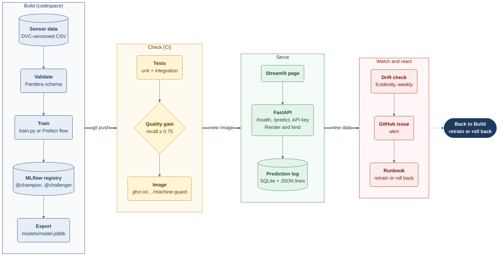

# Machine Guard architecture

How the pieces fit together at the end of Day 4. The diagram is ready; fill in the `TODO` lines underneath with your own links and numbers.

## The flow in one paragraph

Sensor data is versioned with DVC and checked by a Pandera schema before anything trains on it. Training logs every run to MLflow and registers the best model as `@champion`. The champion is exported to `models/` and committed, so every environment gets exactly the same model. Each push runs GitHub Actions: tests, the quality gate (recall on failures at least 0.75), then a Docker image pushed to GitHub Container Registry. Render and the kind cluster run that image. Every prediction is logged. Once a week, a drift check compares new data with the training data and opens a GitHub issue if the inputs have moved. The runbook says what to do next: retrain with the Prefect flow, or roll back to the previous model.

## Your system

| Piece | Where | Value |
|---|---|---|
| Repo | GitHub | `TODO: https://github.com/<you>/machine-guard` |
| Live API | Render | `TODO` |
| Streamlit page | Streamlit Community Cloud | `TODO` |
| Image | GHCR | `TODO: ghcr.io/<you>/machine-guard:<tag>` |
| Champion model | MLflow | `TODO: version, recall, precision` |
| CI | GitHub Actions | `TODO: link to the last green run` |
| Drift alert | GitHub Actions + Issues | `TODO: link to the alert issue` |

## Design choices and trade-offs

| Choice | Why | What we gave up |
|---|---|---|
| Model files committed to Git | Docker, CI, Render and kind can all build without the MLflow database | Repo grows by a few MB per model version |
| Recall gate at 0.75 | A missed breakdown costs about 20 false alarms | More false alarms are accepted |
| Weekly drift check, not real-time | Free, simple, enough for slow changes like a new supplier | A sudden sensor fault could go unnoticed for days |
| Promotion moves an alias; shipping is a human step | A person checks before a new model goes live | Slower than fully automatic deployment |
| `TODO: one choice of your own` | | |
